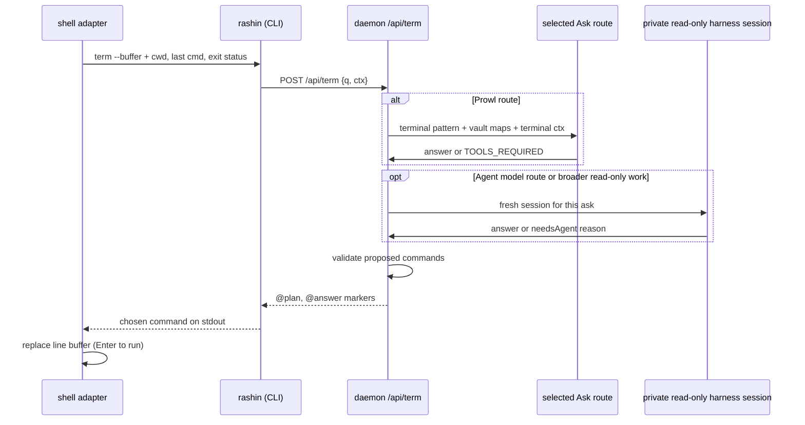

# Rashin in the terminal

The `rashin` command brings Rashin's read-only Ask lane to the place Ryoku
users already work: kitty running fish, or any shell over a terminal. It uses
the same daemon, vault, Ask route, saved harness model, and
`rashin-asks.jsonl` history as the launcher's `\` ask, the Alt+Space Ask tab,
and the console Ask sheet. It does not write into the persistent Agent
conversation.

```
$ rashin take me to the fastfetch config
  Fastfetch's config is ~/.config/fastfetch/config.jsonc, owned by ryoku-fastfetch.

  1 ◇ cd ~/.config/fastfetch && bat config.jsonc

$ cd ~/.config/fastfetch && bat config.jsonc█   <- sitting at your prompt, Enter runs it
```

Rashin never runs a proposed command on this lane. It proposes; you press
Enter.

## What it learned from the field

The design deliberately steals from and rejects parts of the existing tools:

| Tool | Takes | Leaves |
|---|---|---|
| shell-gpt, aichat | Buffer injection: the suggestion lands on the command line for review, via shell integration and a hotkey | A generic prompt with no machine knowledge |
| nlsh | Never auto-execute; the human is the executor | |
| butterfish | Terminal context rides along: cwd, last command, its exit status | Wrapping the whole shell in a PTY interceptor |
| Amazon Q CLI | Context-aware suggestions | The OSC/qterm input-interception layer (fights fish's own autosuggestions, huge surface) |
| atuin | Repetition is a signal: frequent history entries are alias candidates | A second history database |
| agent safety research | Tiered command classification (read / write / system / danger), deny-first | Allowlist-as-security theater: the user executes, so classification informs rather than gates |

None of them know the machine. Rashin does: the vault already maps every
config, owner, reload command, package, and the user's own divergences. The
terminal lane is that knowledge pointed at the prompt.

## The surface

`rashin` is the `ryoku-rashin` binary invoked under a second name (a symlink,
the busybox pattern); inside interactive fish a thin function shadows it to add
buffer injection. Everything meaningful lives in the daemon, so bash, zsh, and
SSH sessions get the same brain with plain-text output.

```
rashin <what you want>        ask; actionable asks come back as a command plan
rashin -c <follow-up>         continue the previous terminal exchange
rashin -r | --resume          list recent asks, recall one instantly (no model call)
rashin --last                 reprint the last answer and plan
rashin recipes                list learned shortcuts (Fish, Bash, and Zsh)
rashin recipe save <name>     save the last plan as a recipe
rashin recipe rm <name>       remove a recipe
```

Flags: `--copy` puts the plan's one-liner on the clipboard, `--run` executes
here with tiered confirmation, `--buffer` keeps presentation on stderr and
prints only the final buffer text on stdout, and `--plain` disables ANSI
(automatic when stdout is not a TTY). `rashin status|enable|disable|setup`
pass through to the matching `ryoku-rashin` verbs.

### Resume an Agent session in its harness

`ryoku-rashin terminal` is separate from the read-only `rashin` ask. It asks
the running daemon to resume the current Agent session in the harness's own
TUI. `--lane chat` does the same for the console Chat session. Hermes, omp,
Claude Code, and Codex support resume; a harness without a resumable session
returns a plain reason instead of opening a new one. The console and bar expose
the Agent action as **Open in terminal**.

Also bound in Fish, Bash, and Zsh: **Alt+R** transmutes the current command
line. Type `find every heic in Photos and convert to jpg`, hit Alt+R, and the
buffer is replaced by the proposed command. Nothing runs until Enter.

## How an ask flows



1. The CLI collects terminal context: cwd, last command, and exit status from
   the active shell adapter. Nothing else leaves the process.
2. With a Prowl route selected, `POST /api/term` starts with the same
   chat-completions loop as `/api/ask`. Its terminal pattern includes the vault
   maps, habits, terminal context, read-only tools (`system_query`,
   `read_file`, `list_dir`, `search_code`, `fetch_url`), and one action tool:
   **`propose`**.
3. When the user asks for a terminal action, the model calls `propose` with
   structured commands. The daemon validates each command, checks its binary
   and source paths, assigns a danger tier, then streams an `@plan` followed by
   the terse `@answer` context. Pure questions return prose without a plan.
4. The **Agent model** Ask route skips Prowl. A Prowl answer that needs broader
   read-only inspection, or a failed route, also falls through to a fresh
   private harness session for this one ask. The selected harness model is
   applied to that session.
5. The private session is strictly read-only. It never asks for approval and
   never joins the persistent Agent transcript. If the request requires it to
   perform a mutation, the result carries `needsAgent` and a short explanation
   of what the Agent would do. It can still propose commands for the user to
   review and run.

The Ask route picker offers Agent model first and available Prowl routes after
it. This choice is separate from the saved harness model. A model picked in
any Rashin surface applies to every new, loaded, or respawned session for that
harness, including private terminal asks. If the pick is not currently
offered, the surface reports **Saved model unavailable** and the session keeps
its current model.

Every completed terminal ask is recorded in
`$XDG_STATE_HOME/ryoku/rashin-asks.jsonl`. The launcher's `\resume`, the
terminal's `--resume`, the bar history drawer, and the console Ask sheet can
recall it without another model call. `rashin -c` supplies the previous
terminal exchange as context to a new ask. Neither command changes the Agent
conversation.

## The stdout protocol

`/api/term` streams the Ask marker protocol:

```
@id <request id>          first line; keys cancel for this request
@working <label>          what Rashin is doing right now
@plan <json>              the validated command plan (below)
@answer <json>            answer, route, actions, and optional needsAgent reason
@error <message>
@hint <json>              e.g. {"kind":"repeat","n":3} -> offer a recipe
```

There is no permission marker or Ask permission route. Both the fast path and
the private harness session are read-only. Work that needs mutation is
reported as `needsAgent`, not held on an approval prompt.

The plan payload:

```json
{
  "intent": "move every .png from Documents into Pictures",
  "oneliner": true,
  "commands": [
    {
      "run": "fd -e png . ~/Documents -x mv {} ~/Pictures/",
      "why": "fd walks recursively; -x moves each hit",
      "tier": "write",
      "notes": ["~/Pictures exists (XDG Pictures directory)"]
    }
  ]
}
```

Tiers, computed per command and per pipeline segment, highest wins:

| Tier | Meaning | Examples | `--run` gate |
|---|---|---|---|
| `read` | looks, never touches | `eza`, `bat`, `fd`, `rg`, `df`, `pacman -Q` | y/N |
| `write` | changes user files | `mv`, `cp`, `mkdir`, `sed -i`, `git push` | y/N |
| `system` | root or service state | `sudo ...`, `pacman -S`, `systemctl enable` | y/N |
| `danger` | destructive or irreversible | `rm -rf` near `/` or `~`, `dd of=/dev/..`, `mkfs`, `curl \| sh` | type `yes` |

The classifier is deny-first and pessimistic: an unknown binary classifies as
`write`, never `read`. On the fish path the tier is informational, because the
user is the executor and the buffer is the confirmation step. The tier gates
only `--run`.

## The learning loop

"Grows with use" is three concrete mechanisms, all local, all inspectable:

1. **The habits layer.** A new generated vault file, `habits.md`, joins
   `system.md` and friends: the user's XDG directories by their real names
   (`Pictures` -> `~/Pictures`, localized names included), the modern-stack
   substitutions in force (`ls`->`eza`, `cd`->zoxide, `find`->`fd`,
   `grep`->`rg`, `cat`->`bat`), shell rhythms mined from fish history (top
   commands with subcommand splits, secret-filtered, counts only), recent
   rashin usage, corrections, and saved recipes. It rides into the term *and*
   quick patterns, so both lanes speak the user's dialect, and every wired
   coding agent reads it from the vault for free. Regenerated with the cheap
   two-minute user-layer watcher; the history mining is opt-out
   (`habits.history: false` in `rashin.json`).
2. **The correction report.** When a rashin-injected command is edited before
   running, or fails, the fish hook reports what actually ran and its exit
   status (`/api/term/ran`, loopback, fire-and-forget, only for commands
   rashin itself injected). Proposed-vs-ran pairs land in
   `rashin-runs.jsonl` and surface in `habits.md`, so the model sees its own
   misses on the next ask.
3. **Recipes.** The daemon normalizes ask text and counts near-duplicates;
   the third similar ask streams a `@hint` and the CLI offers
   `rashin recipe save <name>`. A recipe pins the plan as a fish abbreviation
   (`rr-<name>`, expanded inline so the user always sees what runs) in a
   state file the shipped conf.d snippet sources. `rashin recipes` lists them;
   `habits.md` names them so the model suggests the abbreviation instead of
   re-deriving the pipeline.

## Shell adapters

Ryoku ships one adapter for each supported interactive shell:

- Fish uses `commandline`, `fish_postexec`, and native abbreviations.
- Bash uses `READLINE_LINE`, an Alt+R Readline/ble.sh binding,
  `PROMPT_COMMAND`, and ble.sh abbreviations.
- Zsh uses `BUFFER`, an Alt+R ZLE widget, additive `preexec`/`precmd` hooks,
  and aliases.

Each adapter runs `ryoku-rashin term --buffer`, leaves presentation on the
terminal, and places only the chosen command in the editor buffer. A
session-scoped proposal marker causes the next executed command and status to
be reported; unrelated commands are never reported. Generated recipes live
under `$XDG_STATE_HOME/ryoku/rashin-recipes.{fish,bash,zsh}` and are sourced by
their matching adapter.

The adapters are inert when `ryoku-rashin` is absent. A disabled daemon returns
the normal enable/setup guidance without blocking shell startup.

## When things are not ideal

The lane is designed against the messy cases, not the demo:

| Situation | Behavior |
|---|---|
| Daemon not running / Rashin disabled | One line says how to enable it in the Hub or with `ryoku-rashin enable`, then exits 1 |
| No usable harness and no routable Prowl provider | The error says Ask needs Hermes or a Prowl provider |
| Agent model selected | The ask goes directly to a fresh private read-only harness session |
| Prowl route unavailable | Ask falls back to the private read-only harness session; if that also fails, `@error` names the reason |
| Ctrl+C mid-ask | The CLI answers `@id` with `POST /api/term/cancel?id=`; the daemon stops only that request |
| stdout piped / not a TTY | Plain text, no ANSI, no prompts, plan printed inline |
| Model proposes a binary that is not installed | The command gets a note such as `magick: not installed` |
| Model proposes a missing source path | The command gets a note; destination paths remain allowed to be new |
| Model answers with fenced commands instead of `propose` | The daemon lifts fenced or `$ `-prefixed lines into a plan and validates them |
| Multiple proposed steps | Numbered plan; interactive pick selects the first, all, one number, or none |
| Empty ask / Alt+R on an empty buffer | Usage line, no model call |
| Renamed or localized XDG dirs | `habits.md` carries the real names from `user-dirs.dirs` |
| Secrets in shell history | History mining drops credential-shaped lines before counting |
| `wl-copy` missing | `--copy` falls back to printing the line |
| Two asks from two terminals at once | Independent requests, histories, and cancels; neither enters the Agent transcript |

## What stays out, and why

- **No PTY wrapping, no OSC layer, no ghost text.** fish already has
  autosuggestions; a second input layer fights it (Amazon Q documents exactly
  this conflict). The function + one keybind get the value at 1% of the
  surface.
- **No auto-execution, ever, on the terminal lane.** The buffer is the
  confirmation. `--run` exists for scripts and the confirm tiers gate it.
- **No second history database.** fish history and the existing ask JSONL are
  the signal; atuin can join later as an optional source.
- **No new daemon.** The terminal lane is three handlers on the existing
  `ryoku-rashin` daemon; the CLI is a viewer, exactly like the launcher ask.
- **No abbreviations written into user files.** Recipes materialize into a
  rashin-owned state file the conf.d snippet sources; `user.fish` and
  `config.fish` stay untouched.
